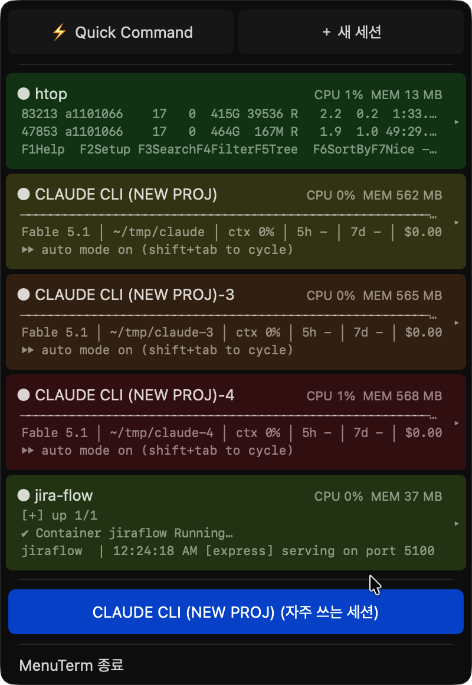
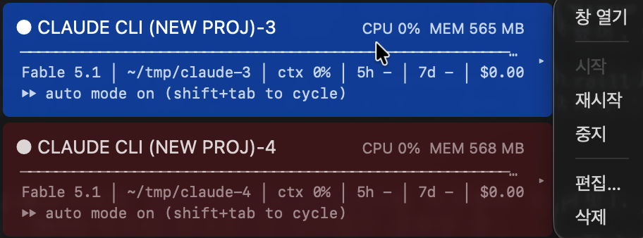
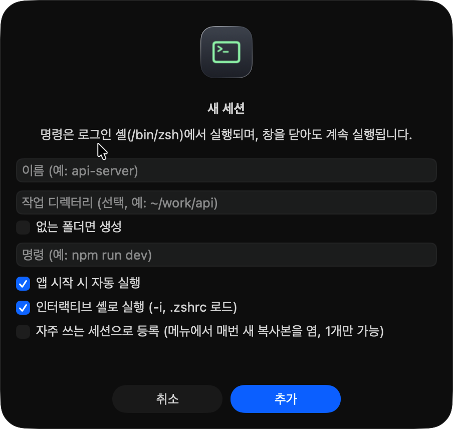
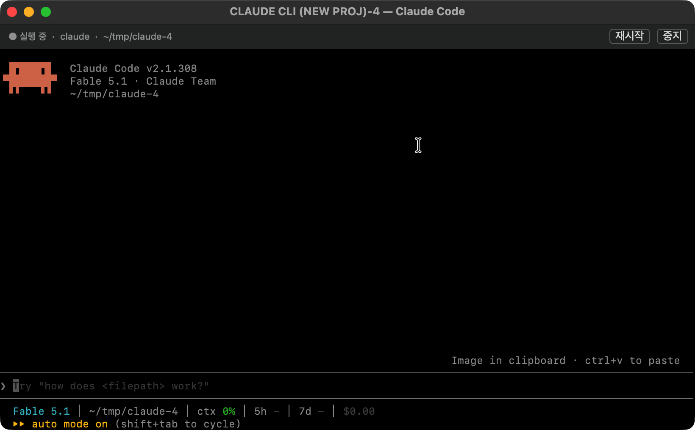

# MenuTerm

**Multi-Terminal in macOS Menu Bar**

macOS 메뉴바에 상주하면서 상시 실행 터미널 세션(개발 서버, 컨테이너, `htop`, Claude Code 같은 CLI 에이전트)을 관리하는 앱입니다.
메뉴를 열면 세션마다 터미널의 마지막 출력 세 줄과 CPU·메모리 사용량이 보이고, 메모리가 큰 순서대로 빨강 → 초록 바탕색이 깔립니다.
단발성 명령은 전역 단축키로 띄우는 소형 터미널에서 처리합니다.
"자주 쓰는 세션" 버튼을 누를 때마다 새 폴더에서 새 창이 하나씩 뜨므로, Claude Code 같은 CLI 에이전트를 작업마다 하나씩 띄우는 런처로도 쓸 수 있습니다.

AppKit + [SwiftTerm](https://github.com/migueldeicaza/SwiftTerm) 으로 작성했으며 Xcode 없이 Swift Package Manager 만으로 빌드됩니다.

<p align="center">
  
</p>

## 특징

- **세션 한눈에 보기**: 메뉴를 연 채로 각 세션의 마지막 출력 3줄, CPU, 메모리가 1 초마다 갱신됩니다.
- **메모리 순위 바탕색**: 셸이 살아 있는 세션을 메모리 순으로 정렬해 가장 무거운 세션은 빨강, 가장 가벼운 세션은 초록 바탕을 깝니다.
- **창을 닫아도 계속 실행**: 세션 창은 숨겨질 뿐이고 프로세스는 그대로 돕니다. 앱 종료 시에만 정리합니다.
- **자주 쓰는 세션 복제**: 한 세션을 템플릿으로 등록하면 메뉴 버튼을 누를 때마다 `폴더-1`, `폴더-2` … 에서 새 창이 하나씩 뜹니다. Claude Code 를 클릭 한 번으로 새 창에 띄우려고 만든 기능입니다 (아래 [예시](#예시-claude-code-를-클릭-한-번으로-새-창에) 참고).
- **Quick Command**: ⌃⇧⌘T 로 어디서든 소형 터미널을 토글합니다.
- **.zshrc 그대로**: 세션은 인터랙티브 로그인 셸 위에서 실행되므로 pyenv, nvm 같은 PATH 설정이 그대로 적용됩니다.

## 요구 사항

- macOS 14.4 이상
- Swift 5.9 이상 툴체인 (`xcode-select --install` 로 설치되는 Command Line Tools 로 충분)

## 설치

```bash
git clone git@github.com:ic4r/menuterm.git && cd menuterm
make install    # build/MenuTerm.app 을 만들어 /Applications 로 복사
open /Applications/MenuTerm.app
```

| 명령 | 동작 |
| --- | --- |
| `make app` | `build/MenuTerm.app` 생성 (아이콘 포함) |
| `make run` | 빌드 후 바로 실행 |
| `make install` | `/Applications/MenuTerm.app` 으로 복사 |
| `swift build` | 디버그 바이너리만 빌드 (`.build/debug/MenuTerm`) |

최초 빌드는 SwiftTerm 컴파일 때문에 1~2 분 걸리고, 이후에는 수 초면 끝납니다.
Ad-hoc 서명이므로 다른 Mac 에 배포하려면 Developer ID 서명과 공증이 필요합니다.

## 사용법

### 메뉴

메뉴바의 터미널 아이콘을 누르면 메뉴가 열립니다. 실행 중인 세션 수가 아이콘 옆에 표시됩니다.

```
 ⚡ Quick Command  │  ＋ 새 세션      ← 반으로 나뉜 버튼 (왼쪽: 소형 터미널, 오른쪽: 등록 폼)
──────────────
● api-server      CPU 3%  MEM 210 MB ▸  ← 세션 행. 클릭하면 창이 열리고 ▸ 는 관리 메뉴
   Listening on :8080
   GET /health 200
   GET /api/users 200
──────────────
claude (자주 쓰는 세션)                   ← 누를 때마다 claude-1, claude-2 … 새 세션
──────────────
MenuTerm 종료
```

세션 행의 ▸ 를 누르면 관리 메뉴가 열립니다. 현재 상태에서 할 수 없는 항목은 비활성화됩니다.

<p align="center">
  
</p>

| 항목 | 동작 |
| --- | --- |
| 창 열기 | 세션 창을 앞으로 가져옵니다. 셸이 없으면 먼저 시작합니다 |
| 시작 | 셸을 띄우고 명령을 입력합니다 |
| 재시작 | 실행 중이면 중지한 뒤 프롬프트로 돌아오는 순간 명령을 다시 입력합니다 |
| 중지 | Ctrl-C 를 보내고, 3 초 뒤에도 살아 있으면 자식 프로세스에 SIGTERM 을 보냅니다 |
| 편집… | 등록 폼을 열어 수정합니다 |
| 삭제 | 실행 중인 프로세스를 끝내고 목록에서 지웁니다 |

| 상태 | 의미 |
| --- | --- |
| ○ | 셸을 아직 띄우지 않음 |
| ● | 명령 실행 중 (셸에 자식 프로세스가 있음) |
| ◐ | 명령이 끝나 프롬프트에서 대기 중 |
| ✕ | 셸 자체가 종료됨 |

### 세션 등록

**＋ 새 세션** 을 누르면 등록 폼이 열립니다.

<p align="center">
  
</p>

| 항목 | 설명 |
| --- | --- |
| 이름 | 메뉴와 창 제목에 쓰는 이름. 비우면 명령이 이름이 됩니다 |
| 작업 디렉터리 | 명령을 실행할 폴더 (`~` 사용 가능). 비우면 홈 |
| 없는 폴더면 생성 | 폴더가 없으면 셸을 띄우기 전에 `mkdir -p` 합니다. 꺼져 있고 폴더가 없으면 홈에서 시작하며 터미널에 안내를 출력합니다 |
| 명령 | 셸 프롬프트에 입력할 명령 (`npm run dev`, `docker compose up`, `claude` …) |
| 앱 시작 시 자동 실행 | MenuTerm 이 뜰 때 바로 시작할지 여부 |
| 인터랙티브 셸로 실행 | `-i` 로 `.zshrc` 를 읽습니다. 끄면 `zsh -l` 만 사용합니다 |
| 자주 쓰는 세션으로 등록 | 이 세션을 복제 템플릿으로 삼습니다. 한 개만 가능하며, 켜면 다른 세션의 설정은 꺼집니다 |

### 세션 창

세션 창 상단에는 상태 · 명령 · 작업 디렉터리와 재시작/중지 버튼이 있고, 그 아래가 터미널입니다.
창을 닫아도(빨간 버튼) 숨기기만 하며 프로세스는 계속 실행됩니다. ⌘C / ⌘V / ⌘A 가 터미널 안에서 동작합니다.

<p align="center">
  
</p>

### 자주 쓰는 세션 (세션 복제)

세션 폼에서 **자주 쓰는 세션으로 등록** 을 켜면 메뉴의 종료 버튼 위에 `이름 (자주 쓰는 세션)` 버튼이 생깁니다.
누를 때마다 같은 명령을 새 작업 디렉터리에서 실행하는 세션이 하나씩 추가됩니다.

- 디렉터리는 `설정한 디렉터리-1`, `-2`, `-3` … 중 폴더가 없고 다른 세션도 쓰지 않는 가장 작은 번호를 고르고, 폴더를 만든 뒤 셸을 띄웁니다.
- 세션 이름은 `이름-번호` 가 되고, 자동 실행이 꺼진 일반 세션으로 목록에 남습니다. 필요 없으면 ▸ 메뉴에서 삭제하면 됩니다(폴더는 남습니다).
- 복제된 세션도 다른 세션과 똑같이 마지막 출력 3줄, CPU, 메모리가 메뉴에 보이고 ▸ 메뉴로 관리할 수 있습니다.

### 예시: Claude Code 를 클릭 한 번으로 새 창에

이 기능은 **Claude Code(`claude` CLI)를 메뉴에서 클릭할 때마다 새 창으로 띄우기 위해** 만들었습니다.
Claude Code 는 실행한 폴더를 작업 공간으로 삼기 때문에, 작업마다 폴더를 따로 두고 각각 별도 창에서 돌리는 편이 편합니다.
아래는 그 설정의 한 예이며, 이름과 폴더는 자유롭게 정하면 됩니다.

| 항목 | 값 (예시) |
| --- | --- |
| 이름 | `CLAUDE CLI (NEW PROJ)` |
| 작업 디렉터리 | `~/tmp/claude` |
| 없는 폴더면 생성 | 켬 |
| 명령 | `claude` |
| 앱 시작 시 자동 실행 | 끔 (템플릿 자체는 띄우지 않아도 됩니다) |
| 자주 쓰는 세션으로 등록 | 켬 |

이렇게 등록하면 메뉴 아래쪽에 **CLAUDE CLI (NEW PROJ) (자주 쓰는 세션)** 버튼이 생깁니다.

```
버튼 클릭 1회 --> ~/tmp/claude-1 생성 --> 새 창에서 claude 실행 --> 메뉴에 "CLAUDE CLI (NEW PROJ)-1" 추가
버튼 클릭 2회 --> ~/tmp/claude-2 생성 --> 새 창에서 claude 실행 --> 메뉴에 "CLAUDE CLI (NEW PROJ)-2" 추가
```

- 창마다 독립된 Claude Code 인스턴스가 돌고, 메뉴에서는 각 인스턴스의 상태 줄(모델, 폴더, 컨텍스트 사용량)과 메모리를 한눈에 비교할 수 있습니다. 첫 번째 스크린샷의 `CLAUDE CLI (NEW PROJ)-3`, `-4` 가 그 상태입니다.
- 창을 닫아도 Claude Code 는 계속 실행되며, 메뉴에서 세션 행을 클릭하면 창이 다시 열립니다.
- 작업이 끝난 인스턴스는 ▸ → 삭제로 정리합니다. 폴더는 남으므로 결과물은 그대로 보존됩니다.
- 기존 프로젝트 폴더에서 열고 싶다면 템플릿 대신 일반 세션으로 그 폴더를 지정해 등록하면 됩니다.

### Quick Command

전역 단축키 **⌃⇧⌘T** (control + shift + command + T) 또는 메뉴의 **⚡ Quick Command** 로 소형 플로팅 터미널을 엽니다.
단축키를 다시 누르면 패널이 숨겨지고 셸은 유지됩니다. 닫기 버튼으로 닫거나 `exit` 를 입력하면 셸이 종료됩니다.
전역 단축키는 Carbon API 로 등록하므로 접근성 권한이 필요 없습니다.

### 세션 동작 방식

- 세션마다 로그인 셸(`$SHELL -l -i`)을 PTY 위에 띄우고, 설정한 명령을 프롬프트에 입력해 줍니다.
  `zsh -lic "<명령>"` 으로 직접 실행하지 않는 이유는 oh-my-zsh 류 플러그인의 백그라운드 워커가 고아 프로세스로 남기 때문입니다.
- 실행 중 여부는 셸에 자식 프로세스가 있는지로 1 초마다 판단합니다.
- CPU 와 메모리는 셸과 그 아래 프로세스 전체를 `proc_pid_rusage` 로 합산합니다. 메모리는 활성 상태 보기의 "메모리" 열과 같은 값(physical footprint)입니다.
- 앱 종료 시 모든 세션에 Ctrl-C 와 `exit` 를 보내고 최대 2.5 초 기다린 뒤 PTY 를 닫습니다.

## 설정 파일

`~/.config/menuterm/sessions.json` (환경 변수 `MENUTERM_CONFIG_DIR` 로 디렉터리 변경 가능). 폼으로 등록하면 자동으로 저장되며 직접 편집해도 됩니다.

```json
[
  {
    "id": "6F1E2C9A-0000-0000-0000-000000000000",
    "name": "api-server",
    "command": "npm run dev",
    "directory": "~/work/api",
    "createDirectory": false,
    "autostart": true,
    "interactive": true,
    "favorite": false
  }
]
```

| 키 | 설명 |
| --- | --- |
| `name` | 메뉴와 창 제목에 쓰는 이름 |
| `command` | 셸에 입력할 명령 |
| `directory` | 작업 디렉터리 (`~` 사용 가능, 생략 시 홈). 폴더가 없으면 홈에서 시작하고 터미널에 안내를 출력 |
| `createDirectory` | `directory` 가 없으면 셸을 띄우기 전에 `mkdir -p` (기본 false) |
| `autostart` | 앱 시작 시 자동 실행 (기본 true) |
| `interactive` | `-i` 로 `.zshrc` 를 읽을지 여부 (기본 true). 끄면 `zsh -l` 만 사용 |
| `favorite` | 자주 쓰는 세션 (한 개만 true, 기본 false) |

세션 안의 셸에는 `MENUTERM=1`, `MENUTERM_SESSION=<이름>` 환경 변수가 들어갑니다.
앱을 `MENUTERM_DEBUG_STATS=1` 로 띄우면 세션별 CPU/메모리 샘플이 1 초마다 stderr 에 기록됩니다.

## 구조

```
Sources/MenuTerm/
├── main.swift                   앱 진입점 (accessory 정책, --write-iconset)
├── AppDelegate.swift            상태 표시줄 아이콘, 메뉴 구성, 액션, 자주 쓰는 세션 복제
├── AppIcon.swift                앱 아이콘 렌더링 (런타임 + 빌드 시 .icns 생성)
├── SessionStore.swift           sessions.json 로드/저장
├── Session.swift                세션 상태 기계 (셸 실행, 명령 입력, 중지/재시작, CPU/메모리 샘플링)
├── SessionMenuRow.swift         세션 행 커스텀 뷰 (CPU/MEM, 마지막 출력 3줄, 메모리 순위 바탕색)
├── SplitMenuRow.swift           버튼형 메뉴 행 (Quick Command | 새 세션, 자주 쓰는 세션)
├── TerminalWindowController.swift  세션 창 (상태 바 + SwiftTerm 뷰)
├── QuickTerminalPanel.swift     단발성 명령용 플로팅 NSPanel
├── NewSessionDialog.swift       세션 추가/편집 폼
├── HotKey.swift                 Carbon 전역 단축키 (⌃⇧⌘T)
└── Shell.swift                  셸 경로, 환경 변수, 프로세스 트리 조회/시그널, proc_pid_rusage
Scripts/build-app.sh             .app 번들 생성 (Info.plist, AppIcon.icns, LSUIElement, ad-hoc 서명)
docs/screenshots/                README 스크린샷
```

## 알려진 제약

- Ad-hoc 서명이므로 다른 Mac 에 배포하려면 Developer ID 서명과 공증이 필요합니다.
- 로그인 시 자동 실행은 아직 없습니다. 시스템 설정 > 일반 > 로그인 항목에 수동으로 추가하면 됩니다.
- 복제 세션의 폴더는 삭제해도 남습니다. 직접 지워야 합니다.

## 라이선스

MIT. 터미널 에뮬레이션은 MIT 라이선스의 [SwiftTerm](https://github.com/migueldeicaza/SwiftTerm) 을 사용합니다.
